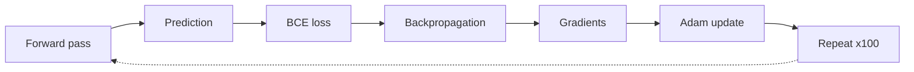

<div align="center">


<a href="https://git.io/typing-svg"></a>


</div>


## 📑 Table of Contents

- [🎯 Project Goal](#-project-goal)
- [📦 Dataset](#-dataset)
- [🧪 Pipeline](#-pipeline)
- [🧱 Architecture](#-architecture)
- [🔍 Findings](#-findings)
- [🧠 Key Decisions](#-key-decisions)
- [✅ Progress & Roadmap](#-progress--roadmap)
- [🚀 Getting Started](#-getting-started)


## 🎯 Project Goal

Build an **Artificial Neural Network in PyTorch** that answers one question:

> **Given a customer's behaviour and account details, will they churn (`1`) or stay (`0`)?**

The network outputs a churn probability between 0 and 1 for every customer.

> [!NOTE]
> **Where I am right now:** the model is trained and the test loss is computed. The next step is turning probabilities into `0/1` predictions and scoring them with accuracy, precision, recall and F1.


## 📦 Dataset

A **synthetically generated** customer churn dataset with **50,000 customers**. It was intentionally built with **nonlinear relationships and feature interactions**, so an ANN has real patterns to learn.

| | | | | |
|---|---|---|---|---|
| `age` | `tenure_months` | `monthly_charges` | `support_tickets` | `late_payments` |
| `usage_hours` | `satisfaction` | `contract_monthly` | `tech_support` | `auto_payment` |

| Item | Detail |
|---|---|
| 🧮 Rows | 50,000 customers |
| 🔢 Input features | 10 (listed above) |
| 🎯 Target | `churn` → `0` = no churn, `1` = churn |
| 🧬 Source | Synthetic (generated) |


## 🧪 Pipeline

```mermaid
flowchart LR
    subgraph DATA["📦 Data prep"]
        A["📄 CSV dataset<br/>50,000 rows"] --> B["🐼 Pandas<br/>load"]
        B --> C["✂️ Separate X and y"]
        C --> D["🔀 Train / test split"]
        D --> E["📏 StandardScaler"]
        E --> F["🔥 PyTorch tensors"]
    end
    subgraph MODEL["🧠 Model"]
        G["🕸️ ANN<br/>10 → 16 → 8 → 1"] --> H["📉 BCE loss + Adam<br/>100 epochs"]
        H --> I["🧪 Test loss<br/>≈ 0.389"]
    end
    subgraph EVAL["📊 Evaluation"]
        J["🎯 Probabilities → 0/1"] --> K["📊 Accuracy · Precision<br/>Recall · F1"]
    end
    F --> G
    I --> J

    classDef done fill:#0d3b2e,stroke:#b4ff3d,stroke-width:2px,color:#ffffff
    classDef next fill:#4a0d4a,stroke:#ff3df2,stroke-width:3px,stroke-dasharray:5 3,color:#ffffff
    classDef todo fill:#1a1a2e,stroke:#6b6b8a,color:#9a9ab8
    class A,B,C,D,E,F,G,H,I done
    class J next
    class K todo
```



🟢 done &nbsp;·&nbsp; 🟣 current step &nbsp;·&nbsp; ⚪ upcoming


## 🧱 Architecture

<div align="center">
  
</div>

| Layer | Operation | Output | Parameters |
|---|---|---|---|
| Input | 10 scaled features | `(N, 10)` | n/a |
| Hidden 1 | `Linear(10 → 16)` + `ReLU` | `(N, 16)` | 176 |
| Hidden 2 | `Linear(16 → 8)` + `ReLU` | `(N, 8)` | 136 |
| Output | `Linear(8 → 1)` + `Sigmoid` | `(N, 1)` | 9 |
| **Total** | | | **321** |

*`N` = number of customers in the batch. In the animation, hidden layer 1 draws 8 of its 16 neurons.*

<details>
<summary><b>🔁 Training loop (click to expand)</b></summary>



</details>

<details>
<summary><b>🖼️ Static diagram (Visual.png)</b></summary>


</details>


## 🔍 Findings

### 📉 Training results (100 epochs)

<div align="center">
  
</div>

| Metric | Value |
|---|---|
| Epochs | 100 |
| Training loss, start | ≈ 0.69 |
| Training loss, end | ≈ 0.39 |
| Test loss | ≈ 0.389 |

> [!NOTE]
> Training loss and test loss ended at nearly the same value (≈ 0.39 vs ≈ 0.389). The chart shows start and end values only, not a per-epoch curve.

### 🎯 Classification metrics

| Metric | Result |
|---|---|
| Accuracy | ⏳ not computed yet |
| Precision | ⏳ not computed yet |
| Recall | ⏳ not computed yet |
| F1-score | ⏳ not computed yet |


## 🧠 Key Decisions

<!-- ✏️ The reasoning below is my wording of standard rationale. Edit it to match your own thinking. -->

<details>
<summary><b>Why an ANN?</b></summary>

The dataset was generated with **nonlinear relationships and feature interactions**. A network with hidden layers and ReLU activations can represent those patterns, which a purely linear model could not.

</details>

<details>
<summary><b>Why 10 → 16 → 8 → 1?</b></summary>

One input per feature, two hidden layers that narrow from 16 to 8 neurons, and a single output neuron for the churn probability. It is small (321 parameters) and easy to inspect.

</details>

<details>
<summary><b>Why ReLU, Sigmoid and BCELoss?</b></summary>

`ReLU` adds nonlinearity in the hidden layers. `Sigmoid` squeezes the output into (0, 1) so it reads as a probability. `BCELoss` is the matching loss for a binary target.

</details>

<details>
<summary><b>Why StandardScaler after the split?</b></summary>

Features sit on very different scales (for example `monthly_charges` vs `satisfaction`), and gradient-based training works better on standardised inputs. The scaler comes after the train/test split in the pipeline.

</details>

<details>
<summary><b>Why Adam?</b></summary>

Adam is a solid default optimiser for this kind of small feed-forward network.

</details>


## ✅ Progress & Roadmap

- [x] Dataset preparation
- [x] Train / test split
- [x] Feature scaling (`StandardScaler`)
- [x] Tensor conversion
- [x] ANN architecture (10 → 16 → 8 → 1)
- [x] Forward propagation and binary cross-entropy loss
- [x] Backpropagation, gradients and Adam optimisation
- [x] 100-epoch training
- [x] Test-set prediction and test loss
- [ ] 👉 **CURRENT:** convert predicted probabilities into `0/1` predictions
- [ ] Evaluate with accuracy, precision, recall and F1-score


## 🚀 Getting Started

```bash
git clone https://github.com/Kartikshard/ann_customer_churn.git
cd ann_customer_churn

python -m venv .venv
source .venv/bin/activate        # Windows: .venv\Scripts\activate

pip install torch pandas numpy scikit-learn jupyter

jupyter notebook <your-notebook>.ipynb
```

<details>
<summary><b>🧩 Model definition</b></summary>

```python
import torch
import torch.nn as nn

model = nn.Sequential(
    nn.Linear(10, 16), nn.ReLU(),
    nn.Linear(16, 8),  nn.ReLU(),
    nn.Linear(8, 1),   nn.Sigmoid(),
)

criterion = nn.BCELoss()
optimizer = torch.optim.Adam(model.parameters())  # set your learning rate here
```

</details>


<div align="center">
  
</div>