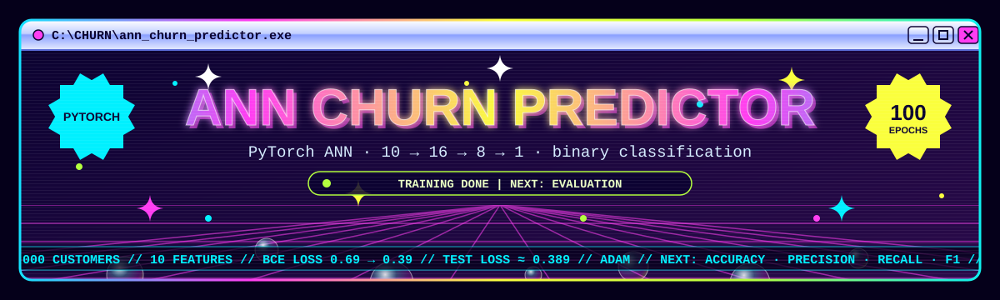
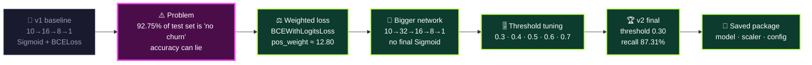
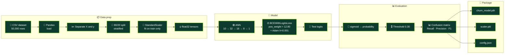
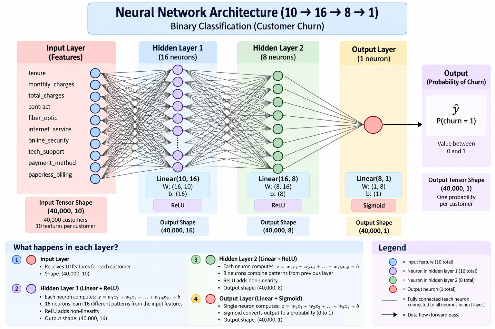
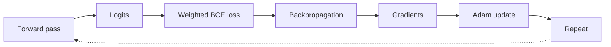
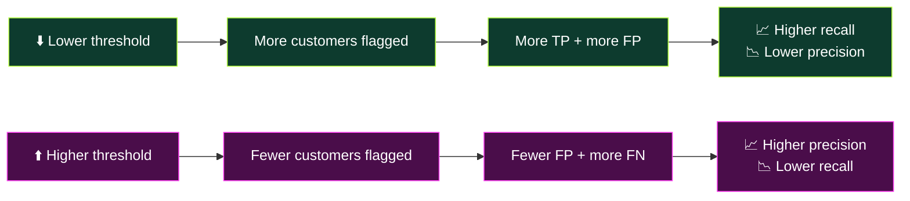
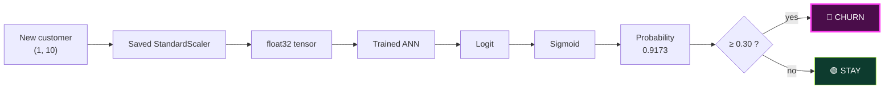

<div align="center">



<a href="https://git.io/typing-svg"></a>


</div>


## 📑 Table of Contents

- [🎯 Project Goal](#-project-goal)
- [📦 Dataset](#-dataset)
- [🗺️ The Journey](#️-the-journey)
- [🧪 Pipeline](#-pipeline)
- [🧱 Architecture](#-architecture)
- [🏋️ Training](#️-training)
- [🔍 Findings](#-findings)
- [🔮 Predicting a New Customer](#-predicting-a-new-customer)
- [📦 Model Package](#-model-package)
- [🧠 Key Decisions](#-key-decisions)
- [✅ Progress & Roadmap](#-progress--roadmap)
- [🚀 Getting Started](#-getting-started)


## 🎯 Project Goal

Build an **Artificial Neural Network in PyTorch** that answers one question:

> **Given a customer's behaviour and account details, will they churn (`1`) or stay (`0`)?**

The ANN outputs a churn **probability**, and a chosen **threshold** turns that probability into the final class.

> [!NOTE]
> The goal was to learn the **complete deep-learning workflow** end to end (data, tensors, architecture, loss, backprop, imbalance, thresholds, saving, inference) rather than to run extensive EDA.

### 🏁 Final result at a glance

| Recall | Precision | F1 | Accuracy | Threshold |
|:---:|:---:|:---:|:---:|:---:|
| **87.31%** | 15.50% | 26.33% | 64.57% | **0.30** |

Low precision is a deliberate trade-off: the project prioritises **catching churners**. See [Findings](#-findings).


## 📦 Dataset

A **synthetically generated** customer churn dataset with **50,000 customers**, intentionally built with **nonlinear relationships and feature interactions** so an ANN has real patterns to learn.

| Feature | Meaning |
|---|---|
| `age` | Customer age |
| `tenure_months` | How long the customer has been with the company |
| `monthly_charges` | Monthly amount charged |
| `support_tickets` | Number of support tickets |
| `late_payments` | Number of late payments |
| `usage_hours` | Customer usage |
| `satisfaction` | Customer satisfaction score |
| `contract_monthly` | Whether the customer has a monthly contract |
| `tech_support` | Whether the customer has technical support |
| `auto_payment` | Whether automatic payment is enabled |

| Item | Detail |
|---|---|
| 🧮 Rows | 50,000 customers |
| 🔢 Input features | 10 |
| 🎯 Target | `churn` → `0` = no churn, `1` = churn |
| 🧬 Source | Synthetic (generated) |
| ✂️ Split | 80 / 20 → **40,000 train**, **10,000 test** (`random_state=42`, `stratify=y`) |

### ⚖️ The class imbalance

<div align="center">

| Test set | Customers | Share |
|---|---:|---:|
| 🟢 Non-churners | 9,275 | 92.75% |
| 🔴 Churners | **725** | **7.25%** |

</div>

The training set has roughly **12.8 non-churners for every churner**. This single fact shaped the second half of the project.

> [!WARNING]
> A model that predicts **"nobody churns"** scores **92.75% accuracy** and catches **0 churners**. Accuracy alone is misleading here.


## 🗺️ The Journey



<details open>
<summary><b>📖 The story in five steps (click to collapse)</b></summary>

1. **v1: get a working network.** Built `10 → 16 → 8 → 1` with `ReLU`, `Sigmoid` and `BCELoss`, trained 100 epochs, and got a clean loss curve (≈ 0.69 → ≈ 0.39).
2. **Spot the trap.** With only 7.25% churners, a low loss and high accuracy do not prove the model finds churners.
3. **Fix the loss.** Switched to `BCEWithLogitsLoss(pos_weight≈12.80)`, which makes a missed churner about 12.8× as costly. The final `Sigmoid` was removed because the loss now includes it, which is also more numerically stable.
4. **Grow the model.** Moved to `10 → 32 → 16 → 8 → 1`. Training lengths were also compared, and **more epochs did not mean a better model**: the weighted model did better at an earlier stage than after running to 10,000 epochs.
5. **Choose the decision rule.** Swept thresholds 0.3 to 0.7 and picked **0.30**, because missing a churner costs more than a false alarm in this project.

</details>


## 🧪 Pipeline



🟢 every stage complete

> [!IMPORTANT]
> **No data leakage:** the scaler is fit on the training data only (`fit_transform`), and the test data only gets `transform`.


## 🧱 Architecture

### 🏆 v2: final model

<div align="center">
  
</div>

| Layer | Operation | Output | Parameters |
|---|---|---|---|
| Input | 10 scaled features | `(N, 10)` | n/a |
| Hidden 1 | `Linear(10 → 32)` + `ReLU` | `(N, 32)` | 352 |
| Hidden 2 | `Linear(32 → 16)` + `ReLU` | `(N, 16)` | 528 |
| Hidden 3 | `Linear(16 → 8)` + `ReLU` | `(N, 8)` | 136 |
| Output | `Linear(8 → 1)` → **logit** | `(N, 1)` | 9 |
| **Total** | | | **1,025** |

*`N` = number of customers in the batch. In the animation, hidden layer 1 draws 8 of its 32 neurons and hidden layer 2 draws 6 of its 16.*

The output is a **logit**: any real number from −∞ to +∞, not yet a probability. `torch.sigmoid` is applied only when evaluating or predicting.

<details>
<summary><b>🕰️ v1: the first model (click to expand)</b></summary>

<div align="center">
  
</div>

| Layer | Operation | Output | Parameters |
|---|---|---|---|
| Input | 10 scaled features | `(N, 10)` | n/a |
| Hidden 1 | `Linear(10 → 16)` + `ReLU` | `(N, 16)` | 176 |
| Hidden 2 | `Linear(16 → 8)` + `ReLU` | `(N, 8)` | 136 |
| Output | `Linear(8 → 1)` + `Sigmoid` | `(N, 1)` | 9 |
| **Total** | | | **321** |

*Hidden layer 1 draws 8 of its 16 neurons.*



</details>


## 🏋️ Training



```python
# class weight = negatives / positives  (≈ 12.8026 on the training set)
pos_weight = (y_train_tensor == 0).sum() / (y_train_tensor == 1).sum()

loss_fn   = nn.BCEWithLogitsLoss(pos_weight=pos_weight)
optimizer = torch.optim.Adam(neural_model.parameters(), lr=0.001)

for epoch in range(num_epochs):
    optimizer.zero_grad()
    y_pred = neural_model(X_train_scaled_tensor)
    loss   = loss_fn(y_pred, y_train_tensor)
    loss.backward()
    optimizer.step()
```

> [!TIP]
> **Lesson learned:** more epochs do not automatically mean a better model. The weighted model performed better at an earlier training stage than after continuing to 10,000 epochs.


## 🔍 Findings

### 🎚️ Threshold tuning (the heart of the project)

The network gives a probability. The threshold decides who gets flagged. Sliding it trades **recall** against **precision**:

<div align="center">
  
</div>

| Threshold | TN | FP | FN | TP | Recall | Precision | F1 | Accuracy |
|:---:|---:|---:|---:|---:|---:|---:|---:|---:|
| **0.3** ⭐ | 5,824 | 3,451 | 92 | 633 | **87.31%** | 15.50% | 26.33% | 64.57% |
| 0.4 | 6,634 | 2,641 | 116 | 609 | 84.00% | 18.74% | 30.64% | 72.43% |
| 0.5 | 7,326 | 1,949 | 164 | 561 | 77.38% | 22.35% | 34.68% | 78.87% |
| 0.6 | 7,875 | 1,400 | 224 | 501 | 69.10% | 26.35% | 38.16% | 83.76% |
| 0.7 | 8,378 | 897 | 271 | 454 | 62.62% | 33.60% | 43.74% | 88.32% |



<details>
<summary><b>🔬 Explore each threshold (click to expand)</b></summary>

<details>
<summary>Threshold <b>0.3</b> ⭐ chosen</summary>

|  | Predicted stay | Predicted churn |
|---|---:|---:|
| **Actually stayed** | 5,824 (TN) | 3,451 (FP) |
| **Actually churned** | 92 (FN) | 633 (TP) |

Catches 633 of 725 churners, but flags 3,451 loyal customers by mistake.

</details>

<details>
<summary>Threshold <b>0.4</b></summary>

|  | Predicted stay | Predicted churn |
|---|---:|---:|
| **Actually stayed** | 6,634 (TN) | 2,641 (FP) |
| **Actually churned** | 116 (FN) | 609 (TP) |

</details>

<details>
<summary>Threshold <b>0.5</b> (conventional default)</summary>

|  | Predicted stay | Predicted churn |
|---|---:|---:|
| **Actually stayed** | 7,326 (TN) | 1,949 (FP) |
| **Actually churned** | 164 (FN) | 561 (TP) |

</details>

<details>
<summary>Threshold <b>0.6</b></summary>

|  | Predicted stay | Predicted churn |
|---|---:|---:|
| **Actually stayed** | 7,875 (TN) | 1,400 (FP) |
| **Actually churned** | 224 (FN) | 501 (TP) |

</details>

<details>
<summary>Threshold <b>0.7</b></summary>

|  | Predicted stay | Predicted churn |
|---|---:|---:|
| **Actually stayed** | 8,378 (TN) | 897 (FP) |
| **Actually churned** | 271 (FN) | 454 (TP) |

</details>

</details>

### 🏆 Final decision: threshold = 0.30

| Metric | Formula | Result |
|---|---|---:|
| Recall | 633 / (633 + 92) | **87.31%** |
| Precision | 633 / (633 + 3,451) | 15.50% |
| F1-score | harmonic mean | 26.33% |
| Accuracy | (5,824 + 633) / 10,000 | 64.57% |

> [!NOTE]
> The low precision is expected. Choosing an aggressive threshold to maximise churn detection means flagging many customers who would have stayed. If a retention offer is cheap relative to losing a customer, this is the right side of the trade-off. If outreach is costly, a higher threshold from the table above fits better.

### 🕰️ v1 baseline: unweighted model, 100 epochs

<div align="center">
  
</div>

| Metric (v1, unweighted `BCELoss`) | Value |
|---|---|
| Epochs | 100 |
| Training loss, start | ≈ 0.69 |
| Training loss, end | ≈ 0.39 |
| Test loss | ≈ 0.389 |

> [!NOTE]
> These losses belong to the **v1 baseline** and are not comparable with the weighted loss of the final model, because `pos_weight` changes the loss scale. A low v1 loss also did not guarantee good churn detection, which is why the project moved to a weighted loss and threshold tuning.


## 🔮 Predicting a New Customer

<div align="center">
  
</div>



<details>
<summary><b>🧑 Example customer and inference code (click to expand)</b></summary>

| Feature | Value |
|---|---:|
| `age` | 35 |
| `tenure_months` | 12 |
| `monthly_charges` | 80 |
| `support_tickets` | 5 |
| `late_payments` | 2 |
| `usage_hours` | 25 |
| `satisfaction` | 6 |
| `contract_monthly` | 1 |
| `tech_support` | 0 |
| `auto_payment` | 0 |

```python
import json, joblib, torch, torch.nn as nn, pandas as pd

model = nn.Sequential(
    nn.Linear(10, 32), nn.ReLU(),
    nn.Linear(32, 16), nn.ReLU(),
    nn.Linear(16, 8),  nn.ReLU(),
    nn.Linear(8, 1),
)
model.load_state_dict(torch.load("models/churn_model.pth"))
model.eval()

scaler    = joblib.load("models/scaler.pkl")
threshold = json.load(open("models/config.json"))["threshold"]   # 0.3

customer = pd.DataFrame([{
    "age": 35, "tenure_months": 12, "monthly_charges": 80,
    "support_tickets": 5, "late_payments": 2, "usage_hours": 25,
    "satisfaction": 6, "contract_monthly": 1,
    "tech_support": 0, "auto_payment": 0,
}])

x = torch.tensor(scaler.transform(customer), dtype=torch.float32)   # shape (1, 10)

with torch.no_grad():
    prob = torch.sigmoid(model(x)).item()                           # ≈ 0.9173

print("CHURN" if prob >= threshold else "STAY", f"({prob:.2%})")
```

</details>


## 📦 Model Package

```text
models/
├── churn_model.pth   # state_dict: learned weights and biases
├── scaler.pkl        # fitted StandardScaler (joblib)
└── config.json       # {"threshold": 0.3}
```

| File | Why it matters |
|---|---|
| `churn_model.pth` | What the ANN learned during training |
| `scaler.pkl` | New data **must** be scaled with the same training statistics |
| `config.json` | Stores the chosen decision threshold so inference matches evaluation |


## 🧠 Key Decisions

<details>
<summary><b>Why an ANN?</b></summary>

The dataset was generated with **nonlinear relationships and feature interactions**. A network with hidden layers and ReLU activations can represent those patterns, which a purely linear model could not.

</details>

<details>
<summary><b>Why 10 → 32 → 16 → 8 → 1?</b></summary>

The first model was `10 → 16 → 8 → 1`. It was later widened to `10 → 32 → 16 → 8 → 1`: one input per feature, three hidden layers that narrow step by step, and a single output for churn. It stays small (1,025 parameters) and easy to inspect.

</details>

<details>
<summary><b>Why BCEWithLogitsLoss instead of Sigmoid + BCELoss?</b></summary>

`BCEWithLogitsLoss` fuses sigmoid and binary cross-entropy in one numerically stable operation, so the model's last layer outputs raw logits. It also accepts `pos_weight`, which was needed for the imbalance.

</details>

<details>
<summary><b>Why pos_weight ≈ 12.80?</b></summary>

Training had about 12.8× more non-churners than churners. Weighting positives by `negatives / positives` makes a missed churner about 12.8× more costly, so the model can no longer ignore the minority class. This significantly increased recall.

</details>

<details>
<summary><b>Why StandardScaler, and why fit on train only?</b></summary>

Features sit on very different scales (for example `usage_hours` vs `support_tickets`), and gradient-based training works better on comparable scales. The scaler learns its mean and variance from the training data only, so nothing from the test set leaks into training.

</details>

<details>
<summary><b>Why Adam (lr = 0.001)?</b></summary>

Adam adapts each weight's step size using the gradients from backpropagation, and it is a solid default for a small feed-forward network.

</details>

<details>
<summary><b>Why threshold 0.30 and not 0.50?</b></summary>

Because the project prioritises catching potential churners. Moving from 0.5 to 0.3 lifts recall from 77.38% to 87.31% (633 vs 561 churners caught) at the cost of precision. The threshold is a business choice, not a fixed model property, which is why it lives in `config.json`.

</details>

<details>
<summary><b>Why not judge by accuracy?</b></summary>

Predicting "no churn" for everyone already gives 92.75% accuracy and detects zero churners. Recall, precision, F1 and the confusion matrix reveal what accuracy hides.

</details>


## ✅ Progress & Roadmap

- [x] Dataset preparation (50,000 synthetic customers)
- [x] Stratified 80/20 train / test split
- [x] Feature scaling (`StandardScaler`, fit on train only)
- [x] Tensor conversion (`float32`)
- [x] v1 ANN (10 → 16 → 8 → 1) with `Sigmoid` + `BCELoss`
- [x] Identified class imbalance (7.25% churners)
- [x] Class-weighted `BCEWithLogitsLoss` (`pos_weight ≈ 12.80`)
- [x] v2 ANN (10 → 32 → 16 → 8 → 1), logits output
- [x] Backpropagation, gradients and Adam optimisation
- [x] Epoch-length experiments (more epochs ≠ better)
- [x] Threshold tuning (0.3 to 0.7) with confusion matrices
- [x] Final threshold 0.30: recall 87.31%, precision 15.50%, F1 26.33%, accuracy 64.57%
- [x] Saved model, scaler and threshold
- [x] New-customer prediction (91.73% → CHURN)

**💡 Possible next steps:** precision-recall curve, cost-based threshold selection, early stopping, comparison with a gradient-boosting baseline.


## 🚀 Getting Started

```bash
git clone https://github.com/Kartikshard/ann_customer_churn.git
cd ann_customer_churn

python -m venv .venv
source .venv/bin/activate        # Windows: .venv\Scripts\activate

pip install torch pandas numpy scikit-learn joblib jupyter

jupyter notebook ann.ipynb
```

<details>
<summary><b>🧩 Final model definition</b></summary>

```python
import torch
import torch.nn as nn

neural_model = nn.Sequential(
    nn.Linear(10, 32), nn.ReLU(),
    nn.Linear(32, 16), nn.ReLU(),
    nn.Linear(16, 8),  nn.ReLU(),
    nn.Linear(8, 1),   # raw logit, no Sigmoid
)

loss_fn   = nn.BCEWithLogitsLoss(pos_weight=pos_weight)   # ≈ 12.80
optimizer = torch.optim.Adam(neural_model.parameters(), lr=0.001)
```

</details>

<details>
<summary><b>🛠️ Tech stack</b></summary>

| Area | Tools |
|---|---|
| Language | Python |
| Data | Pandas, NumPy |
| ML | scikit-learn (`train_test_split`, `StandardScaler`, `confusion_matrix`) |
| Deep learning | PyTorch (`nn.Sequential`, `nn.Linear`, `nn.ReLU`, `BCEWithLogitsLoss`, Adam, tensors, backprop) |
| Persistence | PyTorch `.pth`, Joblib `.pkl`, JSON config |
| Environment | Jupyter Notebook |

</details>


<div align="center">
  
</div>